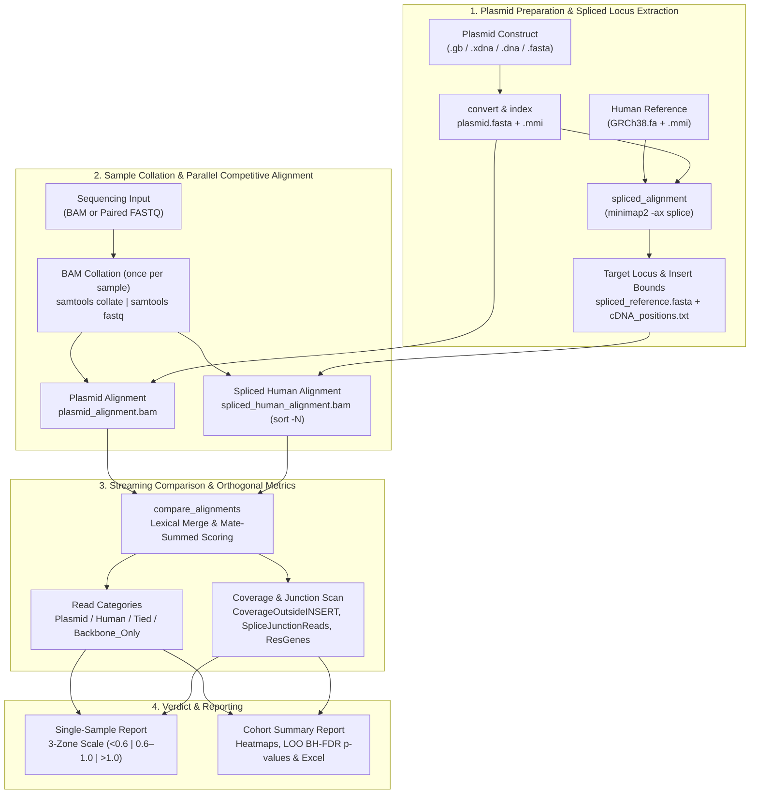

# PlasmiCheck

[](https://github.com/scholl-lab/plasmicheck/actions/workflows/ci.yml)
[](https://github.com/scholl-lab/plasmicheck/pkgs/container/plasmicheck)
[](https://github.com/scholl-lab/plasmicheck/actions/workflows/ci.yml)
[](https://www.python.org/downloads/)
[](https://github.com/scholl-lab/plasmicheck/releases)
[](LICENSE)

Detect and quantify plasmid DNA contamination in short-read sequencing data (BAM and paired/single-end FASTQ).

---

[Overview](#overview) • [Quick Start](#quick-start) • [Installation](#installation) • [CLI Reference](#cli-reference) • [Pipeline Architecture](#pipeline-architecture) • [Outputs & Metrics](#outputs--metrics) • [Development](#development) • [License](#license)

---

## Overview

**PlasmiCheck** identifies recombinant plasmid DNA and cDNA contamination in clinical and research sequencing datasets without requiring prior annotation of the cloned insert. Given a human reference genome, one or more plasmid construct files (`.gb`, `.xdna`, `.dna`, `.fasta`), and sequencing reads (`.bam` or `.fastq.gz`), PlasmiCheck extracts the target human locus via spliced alignment, aligns reads competitively against both references, and produces interactive HTML, static PNG, TSV, and Excel reports.

**Key Capabilities:**

- **Annotation-Free cDNA Insert Mapping:** Spliced alignment (`minimap2 -ax splice`) automatically identifies the target human locus, exon/intron structure, minus-strand orientation, and circular-origin wrap-around coordinates.
- **Paired-End BAM & FASTQ Support:** Coordinate-sorted BAM inputs are collated once per sample (`samtools collate -u -O | samtools fastq`) for paired-end alignment (`minimap2 -ax sr -p`) alongside native paired FASTQ support.
- **Competitive Read Scoring & Tie-Breaking:** Evaluates primary read pairs by mapping quality, edit distance (`NM`), clipping penalties, circular-origin overhangs, and index-size `MAPQ` symmetry.
- **Orthogonal Contamination Evidence:** Quantifies vector-only reads (`Backbone_Only`), base-level `CoverageOutsideINSERT`, vector resistance gene depth/breadth, and direct exon–exon `SpliceJunctionReads`.
- **Single-Sample & Cohort Reporting:** Generates interactive Plotly and static Matplotlib HTML reports with a 3-zone Contamination Scale (`Clean < 0.6`, `Unclear 0.6–1.0`, `Contaminated > 1.0`) and cohort Benjamini–Hochberg FDR outlier statistics.
- **Content-Addressable Caching:** Lock-protected MD5 cache (`~/.plasmicheck/cache`) reuses reference indexes and spliced alignments across batch and Snakemake runs.

---

## Quick Start

```bash
# View CLI help and version
plasmicheck --help
plasmicheck --version

# Screen a BAM sample against a GenBank plasmid construct
plasmicheck pipeline \
  -hf reference/GRCh38.fa \
  -pf reference/plasmid/pCMV6_CACNA1H.gb \
  -sf1 data/sample.bam \
  -o output/ \
  --static-report

# Screen paired-end FASTQ files against a list of plasmids
plasmicheck pipeline \
  -hf reference/GRCh38.fa \
  -pf plasmid_list.txt \
  -sf1 data/sample_R1.fastq.gz \
  -sf2 data/sample_R2.fastq.gz \
  -o output/ \
  --static-report

# Aggregate multi-sample / multi-plasmid results into a cohort summary report
plasmicheck summary_reports \
  -i output/ \
  -o output/summary/ \
  --static-report
```

---

## Installation

### Option 1: `uv` (Recommended)

Requires Python >= 3.10, `bash`, `minimap2` (>= 2.17), and `samtools` (>= 1.19, required for lexicographic `samtools sort -N`):

```bash
git clone https://github.com/scholl-lab/plasmicheck.git
cd plasmicheck
uv sync --locked --no-dev
source .venv/bin/activate
```

### Option 2: Docker (Zero-Setup)

Prebuilt container images bundling Python 3.12, `minimap2`, and `samtools` are published to GHCR:

```bash
docker pull ghcr.io/scholl-lab/plasmicheck:latest

docker run --rm --user $(id -u):$(id -g) \
  -v $(pwd)/data:/data:ro \
  -v $(pwd)/output:/output \
  ghcr.io/scholl-lab/plasmicheck:latest \
  pipeline -hf /data/GRCh38.fa -pf /data/plasmid.gb -sf1 /data/sample.bam -o /output
```

### Option 3: Conda + `uv`

```bash
git clone https://github.com/scholl-lab/plasmicheck.git
cd plasmicheck
conda env create -f conda/plasmicheck_full_conda.yml
conda activate plasmicheck
uv sync --locked --no-dev --python "$CONDA_PREFIX/bin/python"
```

---

## CLI Reference

| Subcommand | Description | Key Flags |
| :--- | :--- | :--- |
| `pipeline` | Run end-to-end contamination detection & reporting | `-hf`, `-pf`, `-sf1`, `[-sf2]`, `-o`, `[--threads]`, `[--static-report]` |
| `convert` | Convert GenBank / SnapGene / xDNA plasmid file to FASTA | `-i`, `-o`, `[-f {genbank,xdna,snapgene,fasta}]`, `[-w]` |
| `index` | Build atomic `.mmi` and `.fai` indexes for a FASTA file | `-f`, `[-w]` |
| `spliced` | Spliced-align plasmid to human genome & extract cDNA coordinates | `-i`, `-p`, `-b`, `-o`, `[-hf]`, `[--cDNA_output]`, `[-d 1000]` |
| `align` | Align sequencing reads to plasmid or spliced human index | `-r`, `-i [FILE ...]`, `-o`, `-a {plasmid,human}` |
| `compare` | Stream-compare name-sorted alignments and compute metrics | `-p`, `-m`, `-o`, `[-t 0.8]` |
| `report` | Generate single-sample interactive & static HTML reports | `-r`, `-s`, `-o`, `[--static-report]`, `[--plot-backend {matplotlib,plotly}]` |
| `summary_reports` | Aggregate cohort comparisons into heatmaps, boxplots & Excel | `-i`, `-o`, `[--static-report]`, `[--plot-backend {matplotlib,plotly}]` |
| `cache` | Inspect or clean `~/.plasmicheck/cache` (`info`, `clean`) | `plasmicheck cache info`, `plasmicheck cache clean --all` |
| `version` | Print ASCII banner and package version | `plasmicheck version` |

### Step-by-Step Modular Execution

```bash
# 1. Convert plasmid construct to FASTA and index references
plasmicheck convert -i plasmid.gb -o plasmid.fasta
plasmicheck index -f plasmid.fasta
plasmicheck index -f GRCh38.fa

# 2. Extract spliced human locus and cDNA insert boundaries
plasmicheck spliced \
  -i GRCh38.mmi \
  -hf GRCh38.fa \
  -p plasmid.fasta \
  -b spliced_alignment.bam \
  -o spliced_reference.fasta \
  --cDNA_output cDNA_positions.txt
plasmicheck index -f spliced_reference.fasta

# 3. Align reads and compare competitive assignments
plasmicheck align -r plasmid.mmi -i sample_R1.fastq.gz sample_R2.fastq.gz -o plasmid_alignment.bam -a plasmid
plasmicheck align -r spliced_reference.mmi -i sample_R1.fastq.gz sample_R2.fastq.gz -o spliced_human_alignment.bam -a human
plasmicheck compare -p plasmid_alignment.bam -m spliced_human_alignment.bam -o results/comparison_result

# 4. Generate HTML report
plasmicheck report \
  -r results/comparison_result.reads_assignment.tsv \
  -s results/comparison_result.summary.tsv \
  -o results/reports/ \
  --static-report
```

---

## Pipeline Architecture



---

## Outputs & Metrics

Each `(sample, plasmid)` comparison writes `<basename>.summary.tsv`, `<basename>.reads_assignment.tsv`, `cDNA_positions.txt`, and HTML reports:

| Metric | Description | Interpretation |
| :--- | :--- | :--- |
| **`Ratio`** | `Plasmid / Human` read count ratio (excluding `Tied` and `Backbone_Only` by default) | `< 0.6`: **Clean** · `0.6 – 1.0`: **Unclear** · `> 1.0`: **Contaminated** |
| **`Plasmid` / `Human` / `Tied`** | Primary reads/pairs scoring higher on plasmid, human, or tied (`CIGAR`/`NM` identical) | Shared cDNA exons tie; junction-spanning or vector-overlapping reads favor `Plasmid` |
| **`Backbone_Only`** | Plasmid-assigned reads with zero overlap with `INSERT_REGION` | Direct evidence of vector backbone DNA |
| **`CoverageOutsideINSERT`** | Total aligned bases outside `INSERT_REGION` divided by insert length | `0.0000` in clean samples; elevated when vector backbone is present |
| **`SpliceJunctionReads`** | Reads spanning cDNA exon–exon boundaries without soft-clipping (`SpliceJunctionsCovered / SpliceJunctionCount`) | Sensitive marker for low-level spliced cDNA contamination even when `Ratio < 0.6` |
| **`ResistanceGenes`** | Mean depth and breadth (`>=1x`) across annotated `AmpR`/`KanR`/`NeoR`/`HygR`/`PuroR`/`Bla` genes | Confirms specific vector construct identity |

---

## Development

Use Python 3.12 (pinned in `.python-version`) and [uv](https://docs.astral.sh/uv/getting-started/installation/).
Python 3.10 remains the compatibility floor; CI tests 3.10, 3.12, and 3.13.
The committed `uv.lock` supplies the same dependencies to local commands and CI.

```bash
make install-dev                  # uv sync --locked; no activation needed
make ci-check                     # lint, formatting, strict typing, coverage, build
make test-fast                    # quick portable tests without coverage
make test-integration             # synthetic pipeline; minimap2 + samtools >=1.19
make lint-actions                 # actionlint via a pinned Docker image
make format                       # safe Ruff fixes and formatting
uv run --locked pre-commit install
```

`make test` enforces **70% combined statement and branch coverage** across the whole package, including the CLI. Keep this baseline stable and raise it when meaningful tests support it; do not exclude difficult modules or lower the floor to make a change pass. Add focused regression tests for behavior changes. `make test-fast` avoids coverage overhead during iteration. Synthetic integration data is committed under `tests/data/synthetic/` and needs no external downloads.

For a dependency change, edit `pyproject.toml` (or use `uv add` / `uv add --dev`), run `uv lock`, then run `make ci-check`, and commit both `pyproject.toml` and `uv.lock` together.

CI also installs the built wheel and sdist outside the checkout, checks package resources and CLI entry points, and builds the Docker smoke-test stage. Tagged releases (`vX.Y.Z` matching `plasmicheck/version.py`) run all CI checks before publishing the runtime container image to GHCR. See [AGENTS.md](AGENTS.md) for the code map and engineering guidelines.

---

## License

MIT License — see [LICENSE](LICENSE) for details.
